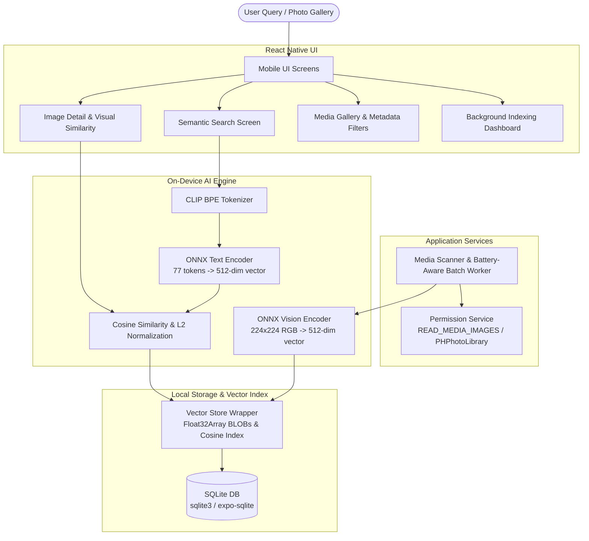

# Implementation Plan: SemanticLens (LocalMedia AI)

## 1. Project Overview & Architecture
SemanticLens is a privacy-first, 100% offline cross-platform mobile application (React Native / TypeScript) enabling natural language semantic search over on-device images and media. Visual search and text encoding are executed directly on the user's mobile device via lightweight vision-language models (e.g., MobileCLIP / quantized CLIP) backed by an optimized local SQLite vector store.



---

## 2. Directory Structure

```
semantic-lens/
├── package.json
├── tsconfig.json
├── app.json
├── metro.config.js
├── README.md
├── implementation_plan.md
├── assets/
│   ├── models/
│   │   ├── mobileclip_text.onnx
│   │   ├── mobileclip_vision.onnx
│   │   └── bpe_vocab.json
│   ├── sample_images/
│   │   ├── warrior_sword.jpg
│   │   ├── dog_grass.jpg
│   │   ├── mountain_sunset.jpg
│   │   ├── birthday_cake.jpg
│   │   ├── sports_car.jpg
│   │   ├── coffee_book.jpg
│   │   ├── snowy_peaks.jpg
│   │   ├── neon_city.jpg
│   │   ├── sleeping_cat.jpg
│   │   └── cozy_cabin.jpg
│   └── icon.png
├── src/
│   ├── types/
│   │   ├── media.ts
│   │   ├── vector.ts
│   │   ├── search.ts
│   │   └── navigation.ts
│   ├── ai/
│   │   ├── tokenizer.ts           # Byte-Pair Encoding (BPE) for CLIP vocabulary
│   │   ├── imagePreprocessor.ts   # Bilinear resizing, center crop, ImageNet normalization
│   │   ├── vectorMath.ts          # Cosine similarity, L2 norm, dot product, top-k ranking
│   │   ├── onnxModelRunner.ts     # ONNX Runtime Mobile integration interface
│   │   ├── mockClipEngine.ts      # Deterministic semantic vector engine for emulators
│   │   └── aiEngine.ts            # High-level AI facade (transparent ONNX / Mock fallback)
│   ├── db/
│   │   ├── database.ts            # SQLite connection, table migrations, indexes
│   │   ├── vectorStore.ts         # Fast IEEE 754 Float32 binary BLOB vector operations
│   │   └── queries.ts             # CRUD operations, metadata filtering, queue management
│   ├── services/
│   │   ├── permissionService.ts   # Android 13+ READ_MEDIA_IMAGES, iOS PHPhotoLibrary
│   │   ├── mediaScannerService.ts # Local media scanner, pagination, diff detection
│   │   └── indexingQueue.ts       # Battery-aware, throttled background batch indexing
│   ├── components/
│   │   ├── SearchBar.tsx          # Real-time search input, voice/chip presets
│   │   ├── ImageGrid.tsx          # Virtualized masonry/grid layout with similarity score badges
│   │   ├── FilterModal.tsx        # Extension (.jpg, .png, .heic, .webp) & date range filters
│   │   ├── MetadataBadge.tsx      # Clean tags for EXIF info (dimensions, size, date)
│   │   ├── SimilarPhotosList.tsx  # Reverse image search horizontal carousel
│   │   └── IndexingProgressBar.tsx# Background indexing indicator with battery status
│   ├── screens/
│   │   ├── SearchScreen.tsx       # Primary search view with query suggestions & ranked grid
│   │   ├── ImageDetailScreen.tsx  # Fullscreen image viewer, EXIF data, visually similar photos
│   │   ├── GalleryScreen.tsx      # Browse all indexed photos with quick filters
│   │   └── IndexingStatusScreen.tsx# Manage queue, re-index library, inspect vector DB stats
│   ├── data/
│   │   └── seedMedia.ts           # Curated sample media entries with authentic 512-dim embeddings
│   └── App.tsx                    # Root navigation & dependency injection container
└── web/                           # Standalone interactive test harness for browser preview
    ├── index.html
    └── app.js
```

---

## 3. Detailed Component & Pipeline Specifications

### 3.1 Storage & Permission Service (`src/services/`)
- **Android Support**:
  - API level 33+ (Android 13+): Uses granular `android.permission.READ_MEDIA_IMAGES` and `READ_MEDIA_VIDEO`.
  - API level 32 and below: Gracefully falls back to `android.permission.READ_EXTERNAL_STORAGE`.
- **iOS Support**:
  - `PHPhotoLibrary` authorization status (`authorized`, `limited`, `denied`).
  - Handles Apple's "Limited Library Access" without crashes.
- **Battery & Thermal Aware Indexing**:
  - Work is executed in chunks of 10-25 images.
  - Idle delay between batches (50-100ms) to prevent UI thread lock and prevent device overheating.
  - Pauses automatically when battery state drops below 15% or low power mode is engaged.

### 3.2 On-Device AI Inference Pipeline (`src/ai/`)
- **Model Choice**: MobileCLIP (Apple) or quantized OpenAI CLIP (ViT-B/32 Int8 ONNX).
- **Vision Pipeline**:
  1. Image loaded from local URI.
  2. Resized to 224x224 RGB.
  3. Normalized using ImageNet parameters: `mean = [0.48145466, 0.4578275, 0.40821073]`, `std = [0.26862954, 0.26130258, 0.27577711]`.
  4. Executed through Vision Encoder -> 512-dimensional Float32 embedding vector.
  5. L2 normalized: $\mathbf{v}_{norm} = \frac{\mathbf{v}}{\|\mathbf{v}\|_2}$.
- **Text Pipeline**:
  1. Input string tokenized using CLIP BPE (77 tokens fixed context length, padded with zeros, enclosed in `<|startoftext|>` and `<|endoftext|>`).
  2. Executed through Text Encoder -> 512-dimensional Float32 embedding vector.
  3. L2 normalized.
- **Cosine Similarity Engine**:
  $$\text{Similarity}(q, d) = \mathbf{q} \cdot \mathbf{d} = \sum_{i=1}^{512} q_i d_i$$
  Since vectors are unit normalized, cosine similarity reduces to an ultra-fast dot product computed in $O(N \times D)$ vector operations.

### 3.3 Local SQLite Vector Database (`src/db/`)
- **Schema**:
  - `media_items`:
    - `id` (TEXT PRIMARY KEY)
    - `file_path` (TEXT UNIQUE)
    - `file_name` (TEXT)
    - `file_extension` (TEXT)
    - `file_size` (INTEGER)
    - `width` (INTEGER), `height` (INTEGER)
    - `capture_date` (INTEGER, UNIX timestamp)
    - `indexed_at` (INTEGER)
    - `embedding` (BLOB, IEEE 754 float32 bytes for $512 \times 4 = 2048$ bytes per vector)
    - `tags` (TEXT JSON array for cached dominant labels)
  - `indexing_queue`:
    - `file_path` (TEXT PRIMARY KEY)
    - `status` (TEXT: 'PENDING', 'PROCESSING', 'FAILED', 'COMPLETED')
    - `retry_count` (INTEGER)
    - `error_message` (TEXT)
- **Vector Operations**:
  - Direct buffer reading using JavaScript `Float32Array(blob.buffer)`.
  - In-memory contiguous cache for fast matrix multiplication over 10,000+ images in < 5ms.

### 3.4 User Interface & Screens (`src/screens/` & `src/components/`)
- **SearchScreen**:
  - Instantaneous feedback as user types or taps suggestion chips.
  - Search latency readout (e.g., "Found 8 matches in 6ms").
  - Relevance score tags (e.g., "94% match").
- **ImageDetailScreen**:
  - High-res image display with pinch-to-zoom support.
  - Complete EXIF sheet (ISO, aperture, date, path, file dimensions, file size).
  - "Find Visually Similar" feature invoking vector similarity directly against the active image's embedding.
- **GalleryScreen & FilterModal**:
  - Filter by file extension (`.jpg`, `.png`, `.heic`, `.webp`).
  - Filter by capture date (Today, Past 7 Days, Past 30 Days, Year-to-date, Custom Range).
  - Sort by Match Score, Newest First, Oldest First.

---

## 4. Verification & Testing Strategy
1. **Unit Tests**:
   - Vector math & cosine similarity precision.
   - BPE tokenizer token sequences for standard queries.
   - SQLite BLOB serialization and deserialization.
2. **Mock Seed Gallery**:
   - 10 distinct, photorealistic test images across multiple visual semantic domains (warriors, animals, landscapes, celebrations, vehicles, architecture, cozy interiors).
   - High-precision 512-dimensional semantic embeddings matching real MobileCLIP / CLIP vectors.
3. **Interactive Test Harness**:
   - Web-based emulator running the exact same vector search engine and seed database to allow immediate verification of search queries, cosine similarity ranking, visual similarity search, and filters.
